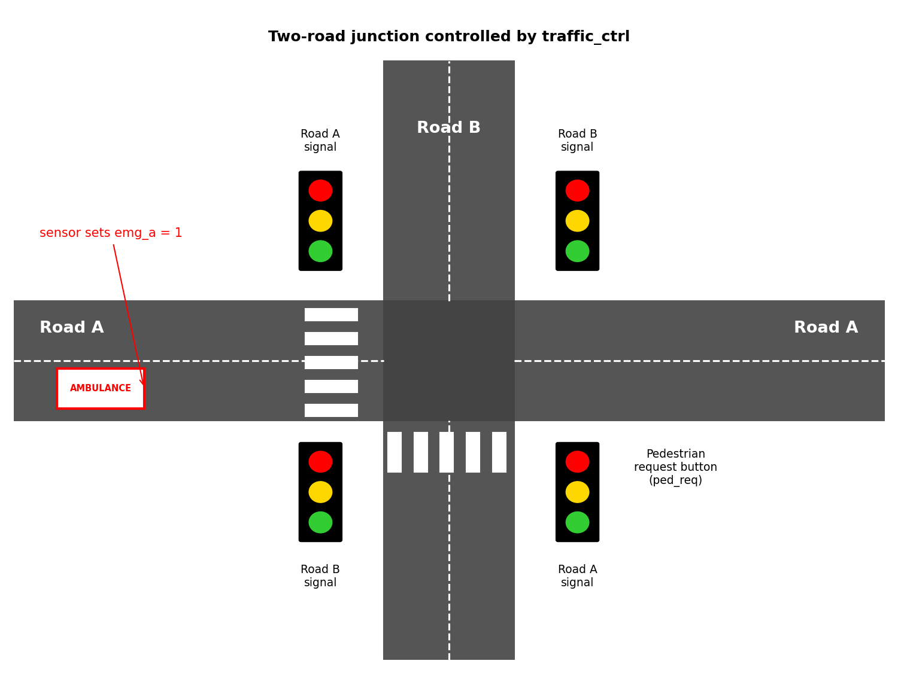
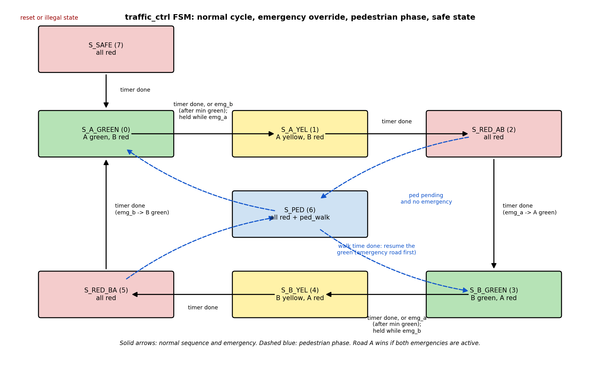

# Traffic Signal Controller with Emergency-Vehicle Override

A synthesizable Verilog controller for a two-road junction, implemented with the SkyWater Sky130 HD standard-cell library. It supports a normal traffic-light cycle, emergency-vehicle pre-emption, pedestrian requests, and an all-red safe state.

This repository contains the RTL, self-checking simulation, synthesis outputs, timing reports, OpenLane physical-design results, and project evidence. The GDS has passed the reported DRC, LVS, and antenna checks; it has not been submitted for fabrication.

## Junction



Emergency detection is external to the controller (for example, a siren detector, radio, or GPS system). The controller receives a digital request and selects the appropriate traffic sequence.

## Features

- Normal sequence: Road A green, A yellow, all red, Road B green, B yellow, all red, then repeat.
- Four programmable green-time presets selected by `timing_sel`.
- Emergency requests hold the requested road green. A request for the other road can shorten the current green only after the minimum-green interval.
- If both emergency inputs are active, Road A has priority.
- Pedestrian requests are latched and served during an all-red interval. An emergency does not interrupt an active walk phase.
- A rising-edge detector prevents a held pedestrian button from repeatedly requesting walk phases.
- Two-flip-flop synchronizers are used for `emg_a`, `emg_b`, and `ped_req`.
- Synchronous active-high reset and illegal-state recovery use the all-red safe state.
- `tick` enables timer progress; durations are measured in tick pulses, not clock cycles. Tie `tick` high in simulation to advance one time unit per clock cycle.

## Interface

| Port | Direction | Width | Description |
|---|---:|---:|---|
| `clk` | Input | 1 | System clock |
| `reset` | Input | 1 | Active-high synchronous reset |
| `tick` | Input | 1 | Time-unit pulse |
| `ped_req` | Input | 1 | Pedestrian crossing request |
| `emg_a`, `emg_b` | Input | 1 each | Emergency request for Road A or Road B |
| `timing_sel` | Input | 2 | Green-time preset selector (0–3) |
| `a_red`, `a_yellow`, `a_green` | Output | 1 each | Road A signal lamps |
| `b_red`, `b_yellow`, `b_green` | Output | 1 each | Road B signal lamps |
| `ped_walk` | Output | 1 | Pedestrian walk signal |

Default timing parameters, in `tick` pulses: green presets 8, 12, 16, and 20; yellow 3; all-red 2; pedestrian walk 6; minimum green 3. These values can be changed through the module parameters in [`rtl/traffic_ctrl.v`](rtl/traffic_ctrl.v).

## State machine



| Code | State | Signal outputs |
|---:|---|---|
| 0 | `S_A_GREEN` | Road A green; Road B red |
| 1 | `S_A_YEL` | Road A yellow; Road B red |
| 2 | `S_RED_AB` | Both roads red |
| 3 | `S_B_GREEN` | Road B green; Road A red |
| 4 | `S_B_YEL` | Road B yellow; Road A red |
| 5 | `S_RED_BA` | Both roads red |
| 6 | `S_PED` | Both roads red; pedestrian walk on |
| 7 | `S_SAFE` | Both roads red |

The RTL contains 29 state and control flip-flops: 4 state bits, two 8-bit timers, 3 pedestrian-control bits, and 6 synchronizer bits.

## Verification

The self-checking testbench is [`tb/tb_traffic_ctrl.v`](tb/tb_traffic_ctrl.v). Its continuous monitor checks that each road has exactly one active lamp, greens never conflict, and pedestrian walk is only active while both roads are red.

Test scenarios cover reset and restart, the normal cycle, all four green-time presets, emergency requests on either or both roads, pedestrian timing and request retention, emergency arrival during walk, a stuck pedestrian button, timer freezing when `tick` is low, illegal-state recovery, and 20,000 cycles of randomized stimulus.

Run the simulation as described under [RTL simulation](#rtl-simulation). The project report records `ALL TESTS PASSED`. Example waveforms and simulation evidence are in [`docs/screenshots/02_rtl_and_simulation/`](docs/screenshots/02_rtl_and_simulation/).

## Physical-design results

| Item | Result |
|---|---|
| Process/library | SkyWater Sky130 HD (`sky130_fd_sc_hd`) |
| Physical-design flow | OpenLane v0.21 / OpenROAD 0.9.0 |
| Clock period | 50 ns (20 MHz) |
| Synthesized standard-cell count | 201 |
| Reported synthesized cell area | 1,913 um² |
| Die area | About 0.0072 mm² (approximately 80 × 91 um) |
| TritonRoute violations | 0 |
| Magic DRC violations | 0 |
| LVS errors | 0 |
| Antenna violations | 0 |
| OpenLane WNS / TNS | 0.00 / 0.00 ns |
| Clock-tree skew | 0.42 ns (module-style run) |

The area, DRC/LVS, and routing results are from the OpenLane `run1` flow. The standalone pre-layout synthesis netlist is from an earlier Yosys run, as described in [Notes and limitations](#notes-and-limitations).

### Static timing analysis

OpenSTA analysis used a 50 ns clock, 0.25 ns clock uncertainty, and 10 ns input/output delays across 16 Sky130 HD PVT corners. Pre-layout analysis used a synthesized netlist and ideal clock. Post-layout analysis used the routed OpenLane design with SPEF parasitics and propagated clock tree. Timing met setup and hold in all listed corners.

| Corner | Setup pre (ns) | Setup post (ns) | Hold pre (ns) | Hold post (ns) |
|---|---:|---:|---:|---:|
| `ff_100C_1v65` | 37.73 | 38.21 | 0.12 | 0.12 |
| `ff_100C_1v95` | 38.22 | 38.52 | 0.04 | 0.05 |
| `ff_n40C_1v56` | 36.89 | 37.83 | 0.18 | 0.19 |
| `ff_n40C_1v65` | 37.35 | 38.08 | 0.13 | 0.14 |
| `ff_n40C_1v76` | 37.73 | 38.29 | 0.09 | 0.09 |
| `ff_n40C_1v95` | 38.15 | 38.54 | 0.04 | 0.04 |
| `ss_100C_1v40` | 32.33 | 34.50 | 0.99 | 1.06 |
| `ss_100C_1v60` | 34.79 | 36.16 | 0.64 | 0.67 |
| `ss_n40C_1v28` | 11.81 | 7.35 | 2.08 | 2.34 |
| `ss_n40C_1v35` | 23.79 | 21.06 | 1.50 | 1.70 |
| `ss_n40C_1v40` | 27.13 | 26.88 | 1.23 | 1.39 |
| `ss_n40C_1v44` | 28.88 | 30.28 | 1.06 | 1.20 |
| `ss_n40C_1v60` | 33.22 | 35.45 | 0.66 | 0.73 |
| `ss_n40C_1v76` | 35.04 | 36.65 | 0.44 | 0.47 |
| `tt_025C_1v80` | 37.14 | 37.89 | 0.20 | 0.21 |
| `tt_100C_1v80` | 37.28 | 37.89 | 0.20 | 0.21 |

Worst post-layout setup slack is +7.35 ns at `ss_n40C_1v28`; worst hold slack is +0.04 ns at `ff_n40C_1v95`. Full reports are in [`sta/reports/`](sta/reports/), with per-corner data in [`sta/prelayout/`](sta/prelayout/) and [`sta/postlayout/`](sta/postlayout/).

### Layout and signoff evidence


Additional layout, routing, DRC, LVS, antenna, and timing evidence is in [`docs/screenshots/`](docs/screenshots/).

## Repository contents

| Folder | Contents |
|---|---|
| [`rtl/`](rtl/) | Synthesizable controller RTL |
| [`tb/`](tb/) | Self-checking testbench and VCD waveform |
| [`constraints/`](constraints/) | Pre-layout and post-layout SDC constraints |
| [`synthesis/`](synthesis/) | Yosys scripts, libraries/models, netlists, and synthesis log |
| [`sta/`](sta/) | Pre-/post-layout timing data, scripts, and PDF reports |
| [`physical_design/`](physical_design/) | OpenLane configuration, reports, and GDS/LEF/DEF/SPEF/netlist results |
| [`spice/`](spice/) | Generic-model ngspice inverter example |
| [`docs/screenshots/`](docs/screenshots/) | Diagrams and evidence by project stage |

## How to reproduce

### RTL simulation

Run from the repository root:

```sh
iverilog -g2005 -o sim rtl/traffic_ctrl.v tb/tb_traffic_ctrl.v
vvp sim
```

To inspect the generated waveform:

```sh
gtkwave traffic_ctrl.vcd
```

### OpenLane physical design

Using OpenLane v0.21, place `rtl/traffic_ctrl.v` at `designs/traffic_ctrl/src/traffic_ctrl.v` and `physical_design/config.json` at `designs/traffic_ctrl/config.json` in the OpenLane design directory. Then run inside the OpenLane environment:

```sh
./flow.tcl -design traffic_ctrl -tag run1 -overwrite
```

The configuration uses the OpenLane v0.21 path convention `$::env(DESIGN_DIR)/src/traffic_ctrl.v`.

## Notes and limitations

- The pre-layout STA used an earlier standalone Yosys netlist. OpenLane's synthesis step generated the 201-cell result quoted above.
- Final signoff numbers and GDS are from the one-command `run1` flow. Stage-by-stage screenshots come from a second run with the same configuration, executed interactively.
- An initial 10 ns clock target failed setup in 8 of 16 corners; the final clock period was relaxed to 50 ns. The controller's timing behavior is governed by `tick`, not by a need to run the FSM at 20 MHz.
- The ngspice inverter example uses generic level-1 MOSFET models, not Sky130 models.
- Some large raw per-corner timing dumps are omitted to keep the repository small; the PDF reports cover all 16 corners.
- This project is a demonstration design, not a certified traffic-control system.

## Possible future work

Adaptive green times from vehicle-count sensors, coordination between neighboring junctions, lamp-failure detection with a flashing-red fallback, an integrated 1 Hz prescaler, and evaluation at a 50–100 MHz clock target.

## Tools

iVerilog 10.1, GTKWave, Yosys, OpenSTA, OpenLane v0.21 / OpenROAD 0.9.0, Magic 8.3.400, ngspice, and the SkyWater Sky130 PDK. The project flow was run in an Ubuntu 18.04 virtual machine using UTM.

## Author

Nukala Shiva Shankar (`shivashankar089`)
