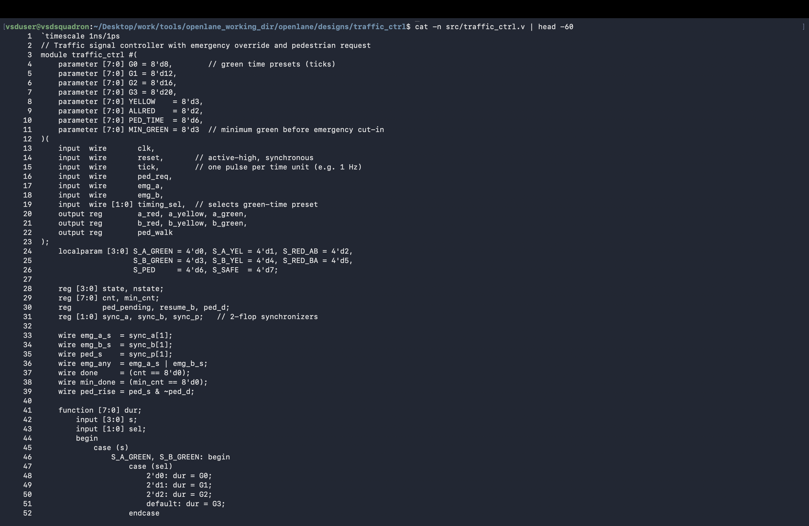
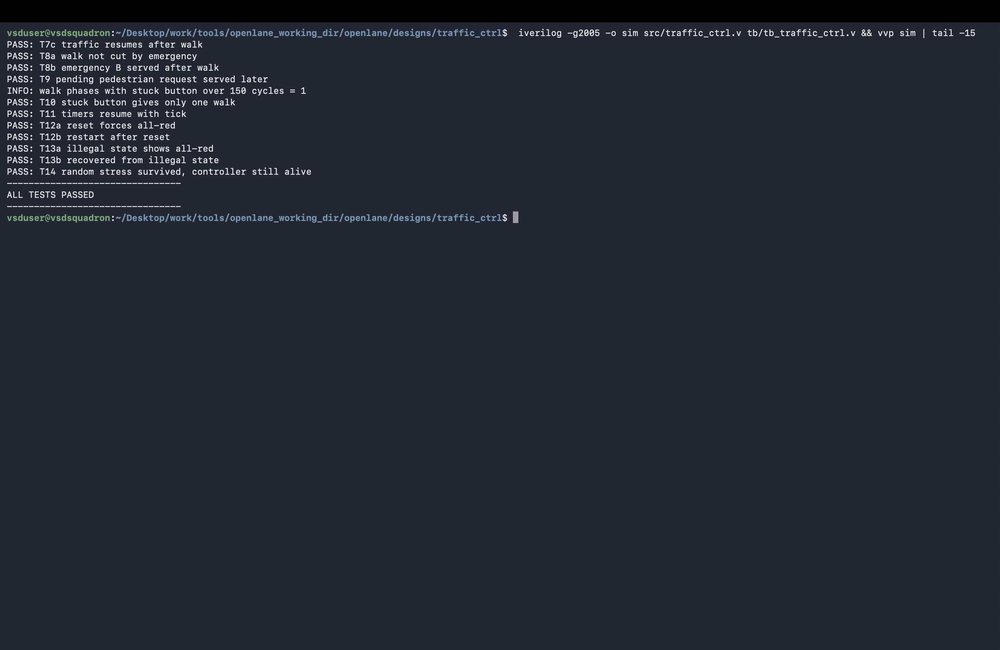
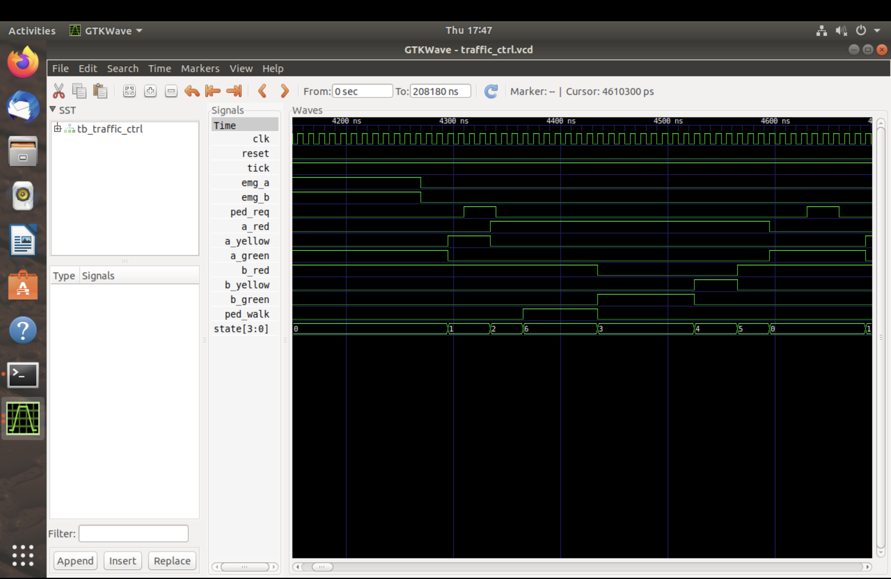
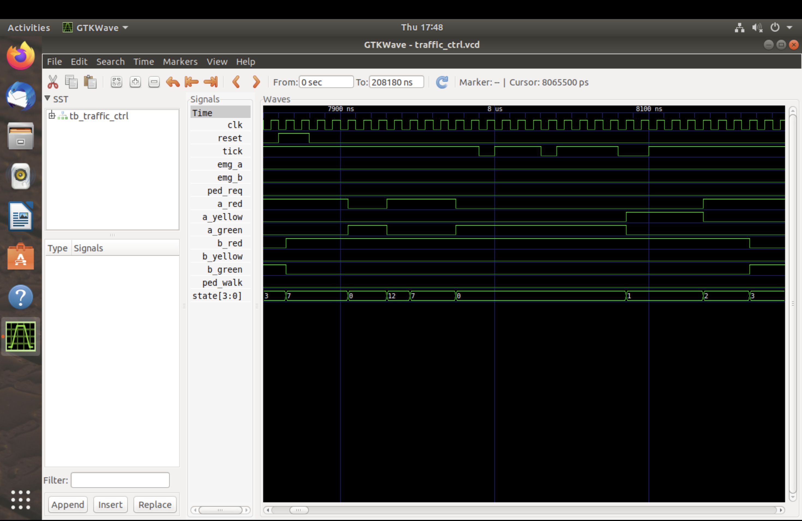

# RTL and Simulation

This section documents the controller RTL and behavioral verification. The design is implemented in [`rtl/traffic_ctrl.v`](../../../rtl/traffic_ctrl.v), and the self-checking testbench is [`tb/tb_traffic_ctrl.v`](../../../tb/tb_traffic_ctrl.v).

## Images

### RTL source



[`03_rtl_code.png`](03_rtl_code.png) is a source-code view of the Verilog controller.

### Testbench result



[`04_simulation_all_tests_passed.png`](04_simulation_all_tests_passed.png) shows the Icarus Verilog testbench completing with `ALL TESTS PASSED`, including pedestrian behavior, reset, illegal-state recovery, timer enable, and randomized stress.

### GTKWave scenarios


[`05_gtkwave_normal_cycle.png`](05_gtkwave_normal_cycle.png) shows signal activity during the normal alternating traffic cycle.


[`06_gtkwave_emergency_override.png`](06_gtkwave_emergency_override.png) shows the controller responding to an emergency request.



[`07_gtkwave_pedestrian_phase.png`](07_gtkwave_pedestrian_phase.png) shows a pedestrian request being served during an all-red interval.



[`08_gtkwave_safe_state_recovery.png`](08_gtkwave_safe_state_recovery.png) illustrates all-red behavior and recovery after reset or an illegal state.

## Reproducing the RTL simulation

From the repository root, compile and run with Icarus Verilog:

```sh
iverilog -g2005 -o sim rtl/traffic_ctrl.v tb/tb_traffic_ctrl.v
vvp sim
```

Open the generated waveform in GTKWave when needed:

```sh
gtkwave traffic_ctrl.vcd
```
