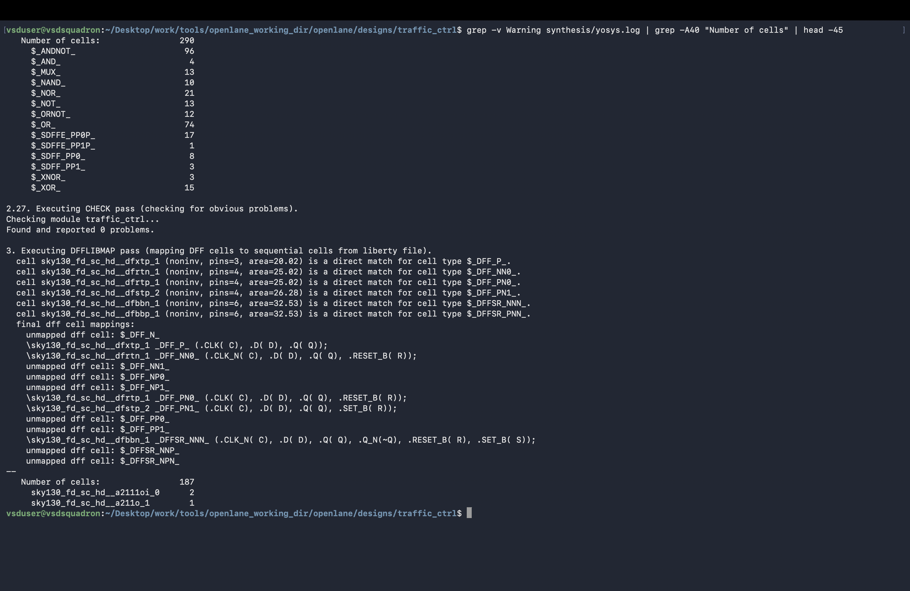
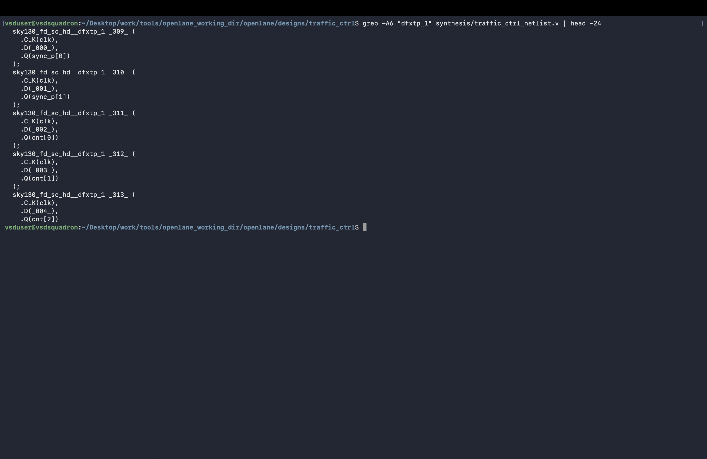
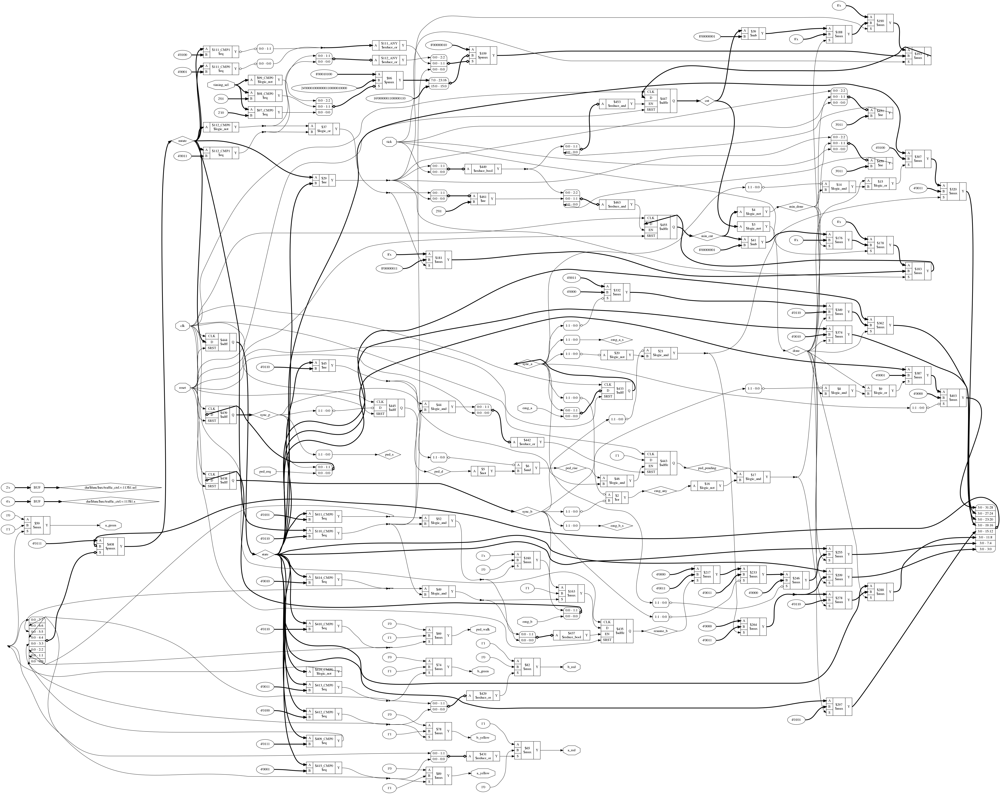
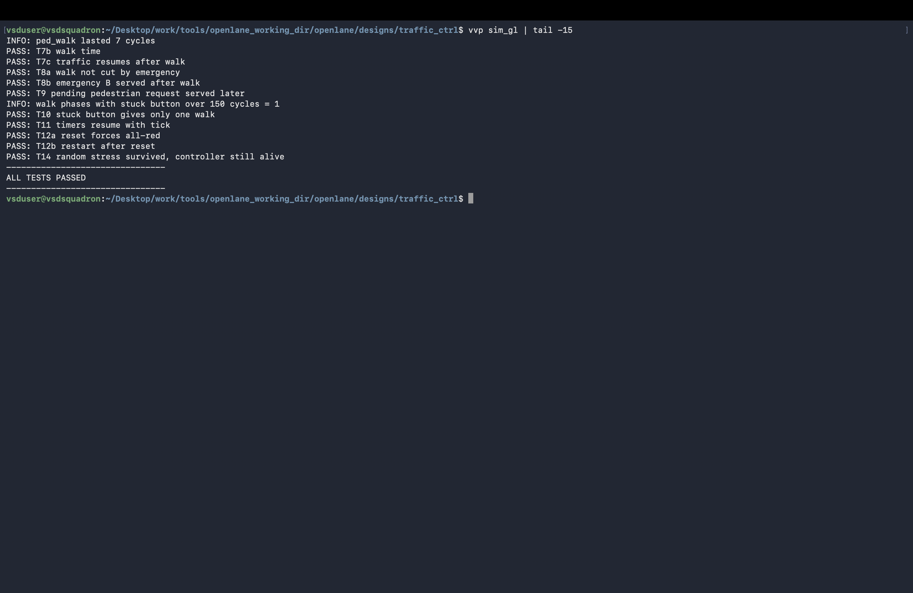

# Synthesis and Gate-Level Simulation

The screenshots in this section show logic synthesis and a subsequent gate-level simulation (GLS). The repository's synthesis scripts, netlists, and logs are in [`synthesis/`](../../../synthesis/); the controller RTL is in [`rtl/traffic_ctrl.v`](../../../rtl/traffic_ctrl.v).

## Images

### Yosys synthesis statistics

[`09_yosys_synthesis_stat.png`](09_yosys_synthesis_stat.png) shows synthesis statistics produced by Yosys for the controller.

### Synthesized netlist

[`09b_synthesis_netlist.png`](09b_synthesis_netlist.png) shows a portion of the generated gate-level Verilog.

### Netlist overview

[`09c_netlist_top_view.png`](09c_netlist_top_view.png) gives a visual overview of the synthesized netlist hierarchy/connectivity.

### Gate-level simulation

[`10_gate_level_sim_pass.png`](10_gate_level_sim_pass.png) shows the gate-level testbench completing with `ALL TESTS PASSED`.

## Context

The screenshot statistics should be interpreted in the context of their synthesis run. The project README distinguishes the standalone Yosys synthesis artifacts from the OpenLane synthesis results used for the final physical-design area and cell-count figures.
