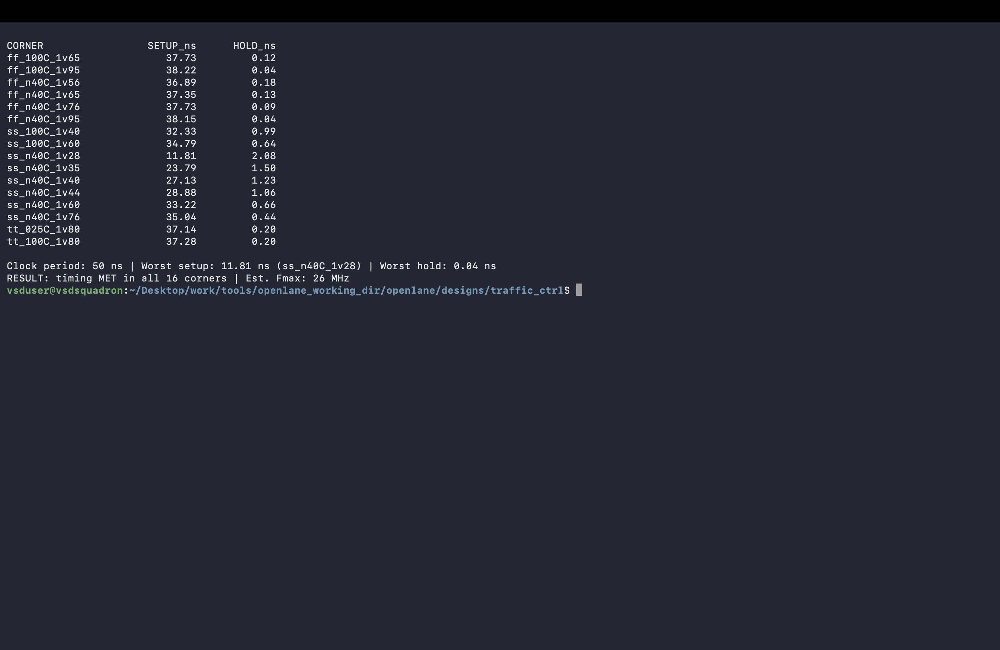
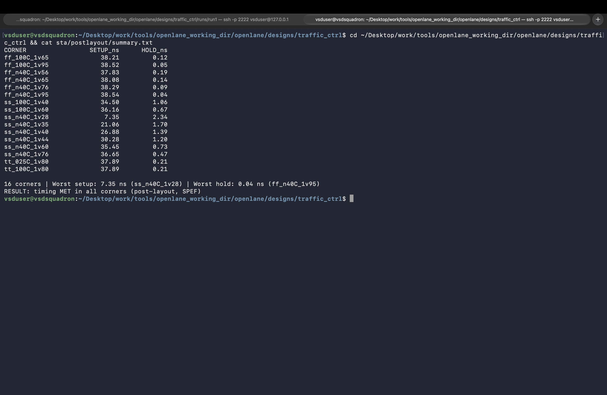

# Static Timing Analysis: 16 Corners

These screenshots summarize static timing analysis (STA) before and after physical layout. Both reports cover 16 Sky130 HD process/voltage/temperature (PVT) corners with a 50 ns clock. The post-layout analysis uses extracted SPEF parasitics. Per-corner reports and scripts are in [`sta/`](../../../sta/).

## Images

### Pre-layout STA

[`11_sta_prelayout_16corners.png`](11_sta_prelayout_16corners.png) presents setup and hold results from the synthesized design before layout.

### Post-layout STA

[`16_sta_postlayout_16corners.png`](../06_signoff_and_gds/16_sta_postlayout_16corners.png) presents setup and hold results after layout with parasitics. The checked report records timing met in all 16 corners; the worst setup slack is 7.35 ns and the worst hold slack is 0.04 ns.

## Related reports

- Pre-layout corner summaries: [`sta/prelayout/`](../../../sta/prelayout/)
- Post-layout corner summaries: [`sta/postlayout/`](../../../sta/postlayout/)
- Full report PDFs: [`sta/reports/`](../../../sta/reports/)
