# OpenLane: Stage-by-Stage

This section follows the OpenLane implementation run from configuration through routing. The captures are from an interactive run using OpenLane v0.21 and the Sky130A PDK. The design configuration is tracked in [`physical_design/config.json`](../../../physical_design/config.json); the project's final signoff evidence is collected separately in [`06_signoff_and_gds/`](../06_signoff_and_gds/).

## Images

### Configuration and synthesis

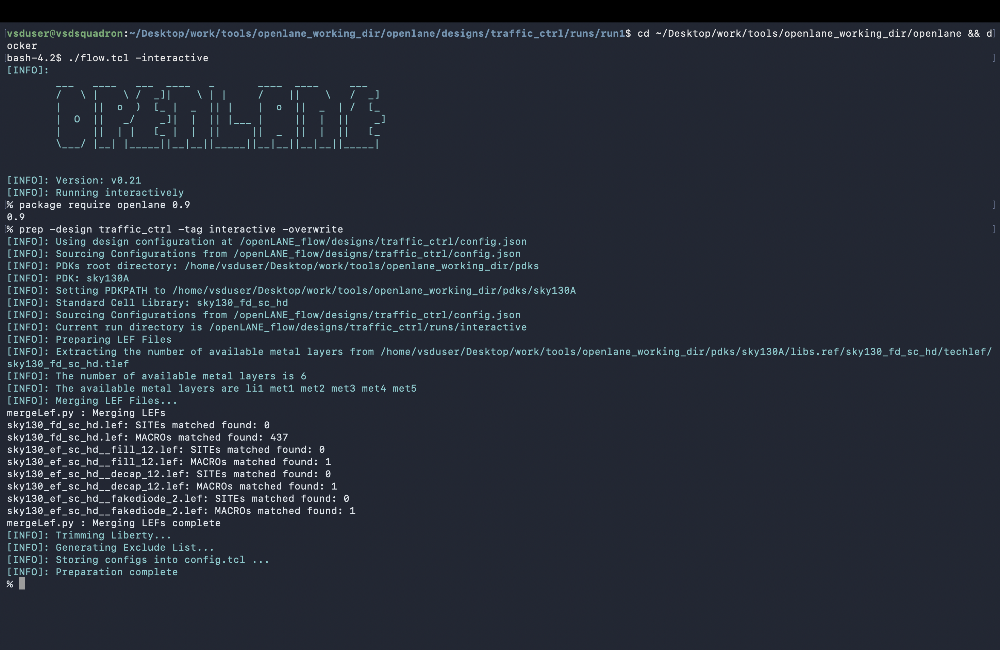

[`00_openlane_configuration.png`](00_openlane_configuration.png) shows OpenLane loading the `traffic_ctrl` configuration and preparing the Sky130 HD standard-cell library.

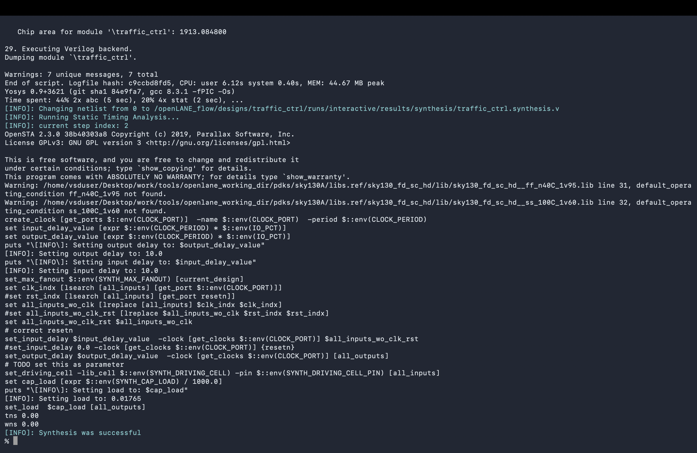

[`01_synthesis_successful.png`](01_synthesis_successful.png) records successful completion of the synthesis stage.

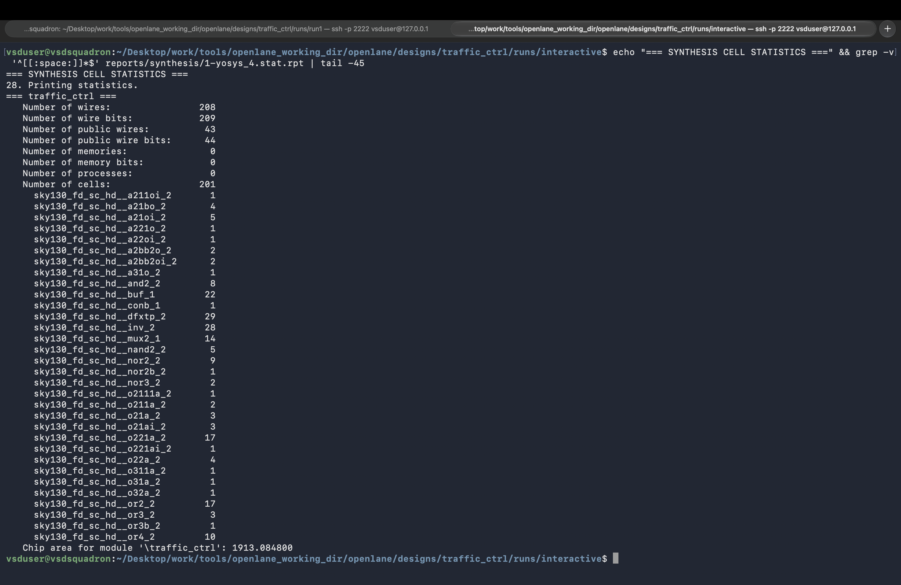

[`02_synthesis_stat_report.png`](02_synthesis_stat_report.png) shows the synthesis statistics report.

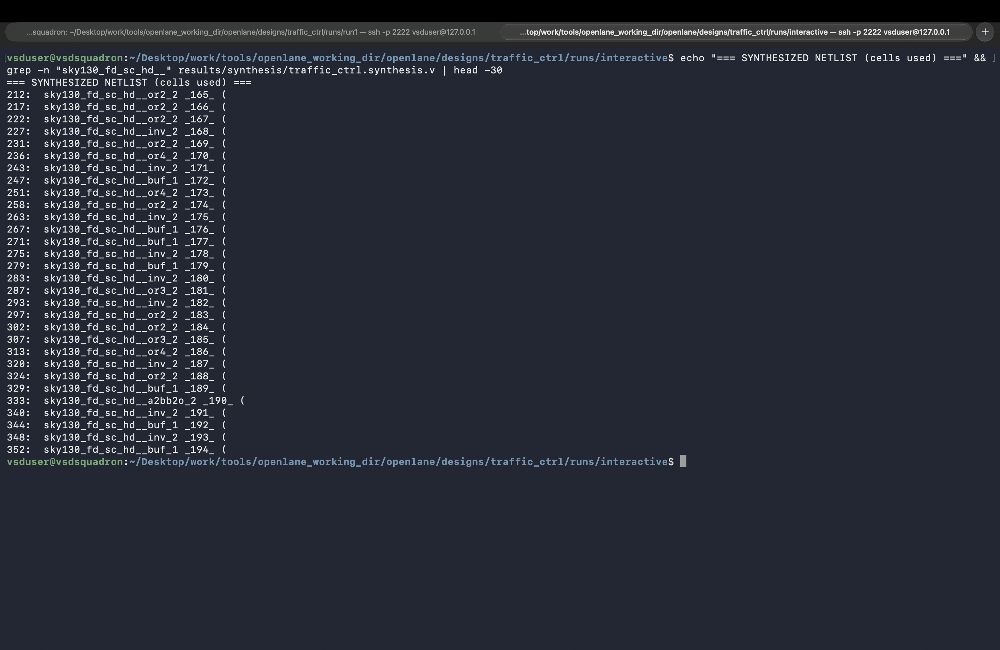

[`03_synthesis_netlist.png`](03_synthesis_netlist.png) shows the generated synthesis netlist artifact.

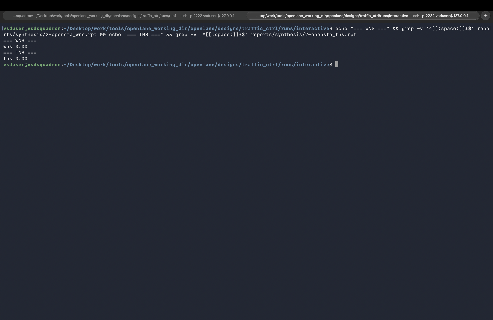

[`04_synthesis_sta.png`](04_synthesis_sta.png) shows timing analysis at the synthesis stage.

### Floorplanning

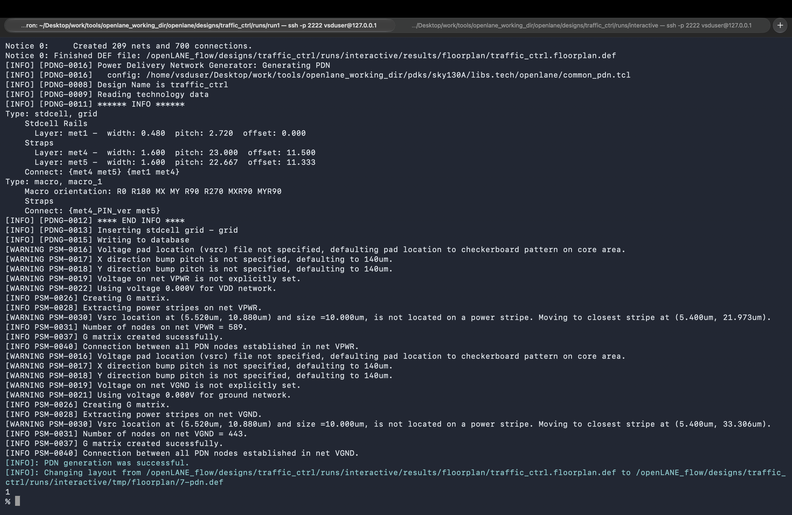

[`05_floorplan_successful.png`](05_floorplan_successful.png) records successful floorplanning.

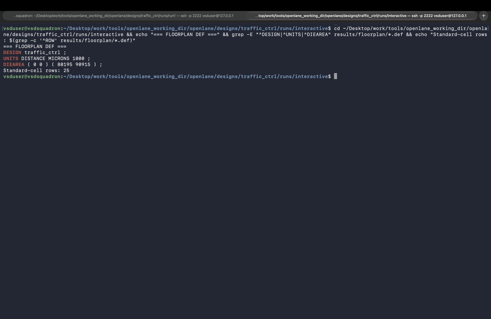

[`06_floorplan_def.png`](06_floorplan_def.png) shows the floorplan represented in DEF.

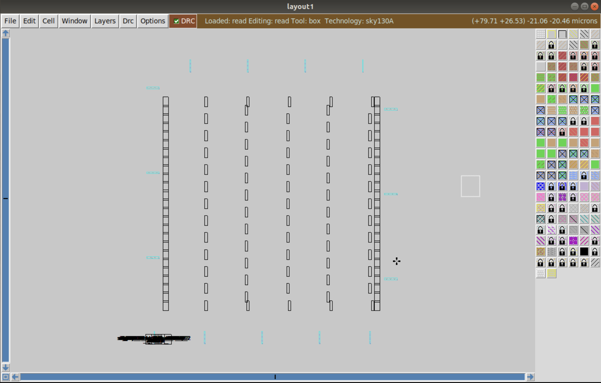

[`07_floorplan_magic.png`](07_floorplan_magic.png) shows the floorplan in the Magic layout viewer.

### Placement

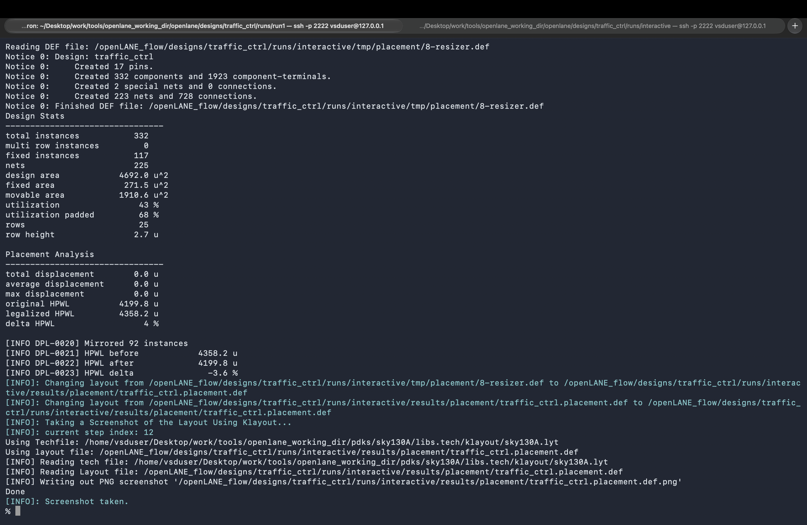

[`08_placement_completed.png`](08_placement_completed.png) records completion of standard-cell placement.

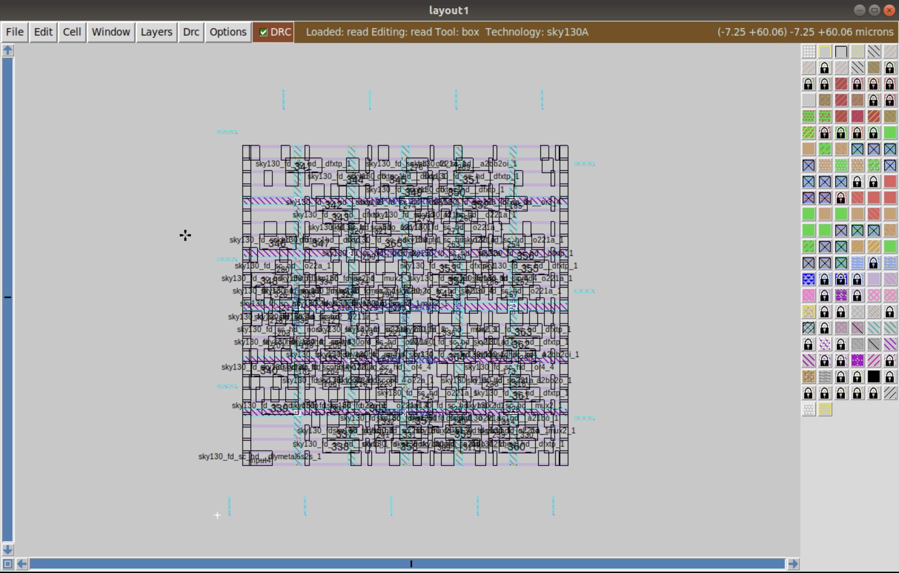

[`09_placement_magic.png`](09_placement_magic.png) shows the placed design in Magic.

### Clock-tree synthesis

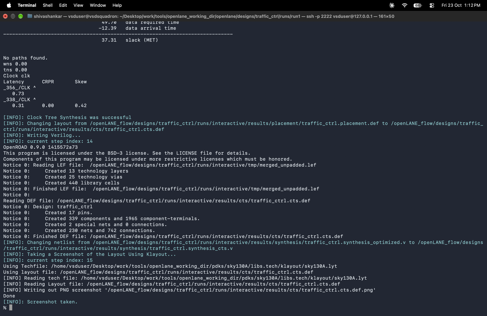

[`10_cts_run_successful.png`](10_cts_run_successful.png) records successful completion of clock-tree synthesis (CTS).

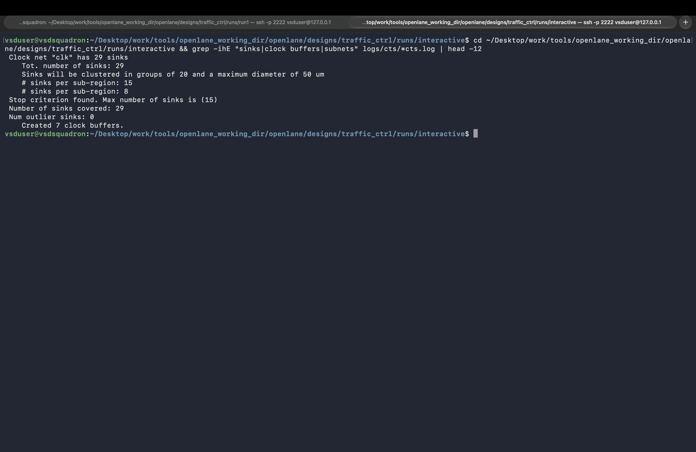

[`11_cts_stats.png`](11_cts_stats.png) shows CTS-related statistics.

### Routing

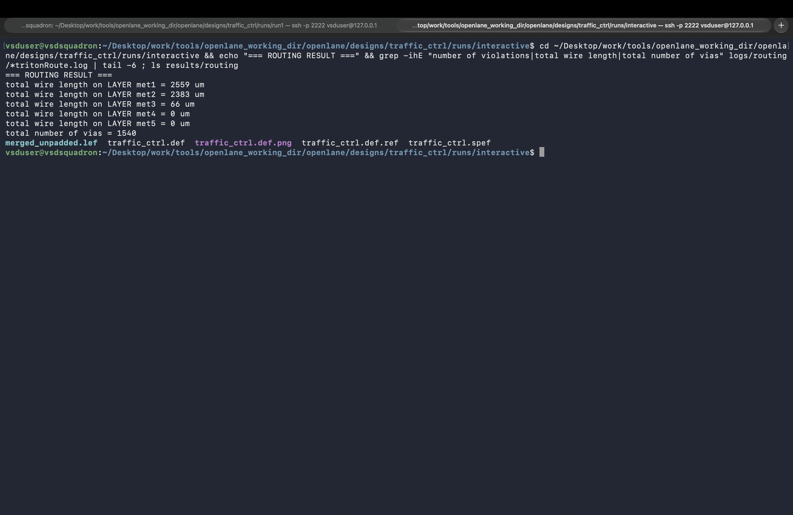

[`12_routing_successful.png`](12_routing_successful.png) records successful completion of routing.

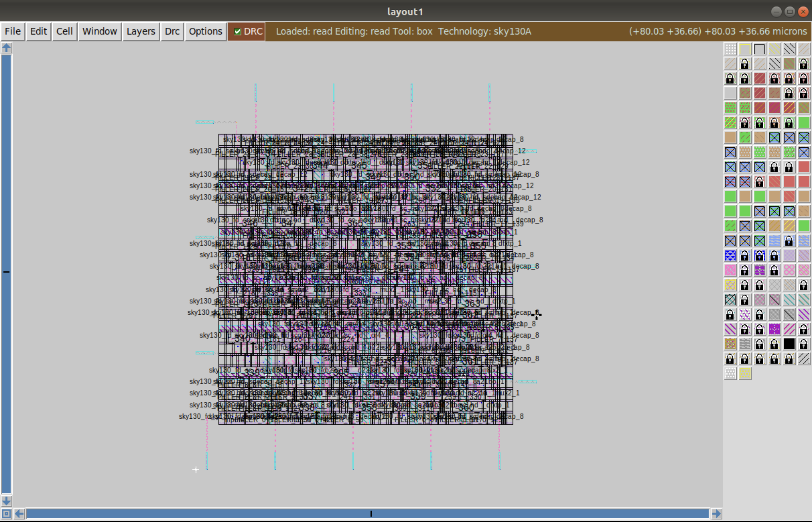

[`13_routing_magic_layout.png`](13_routing_magic_layout.png) shows the routed layout in Magic.

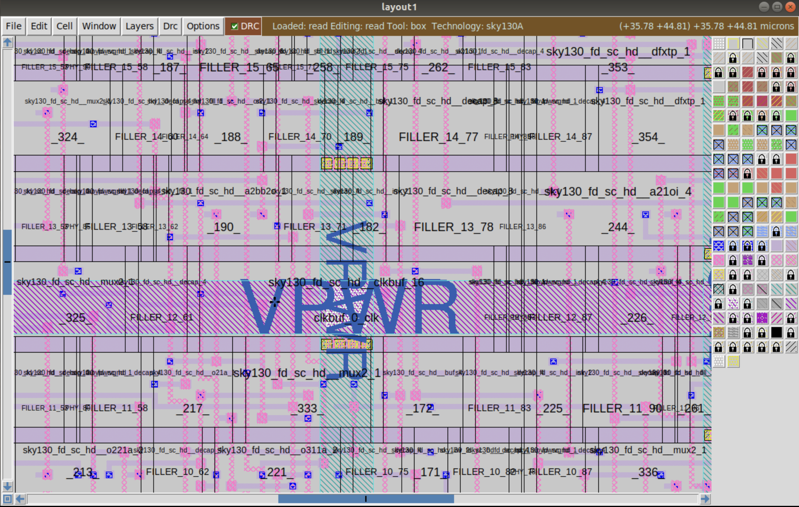

[`14_routing_magic_layout_zoom.png`](14_routing_magic_layout_zoom.png) provides a closer view of the routed layout.

## Scope

These images document intermediate stages, rather than serving as a complete signoff report. For the final GDS, DRC, LVS, antenna, area, and timing evidence, see [`06_signoff_and_gds/`](../06_signoff_and_gds/).
