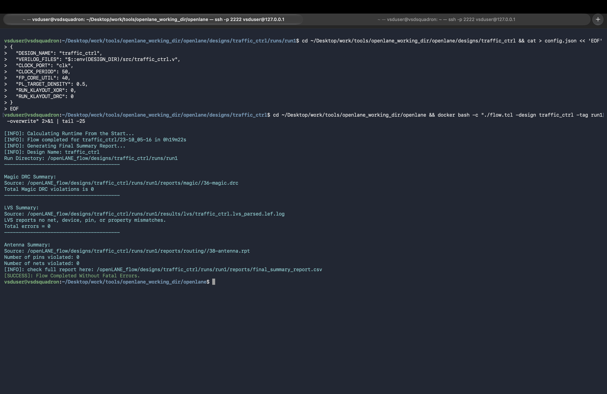
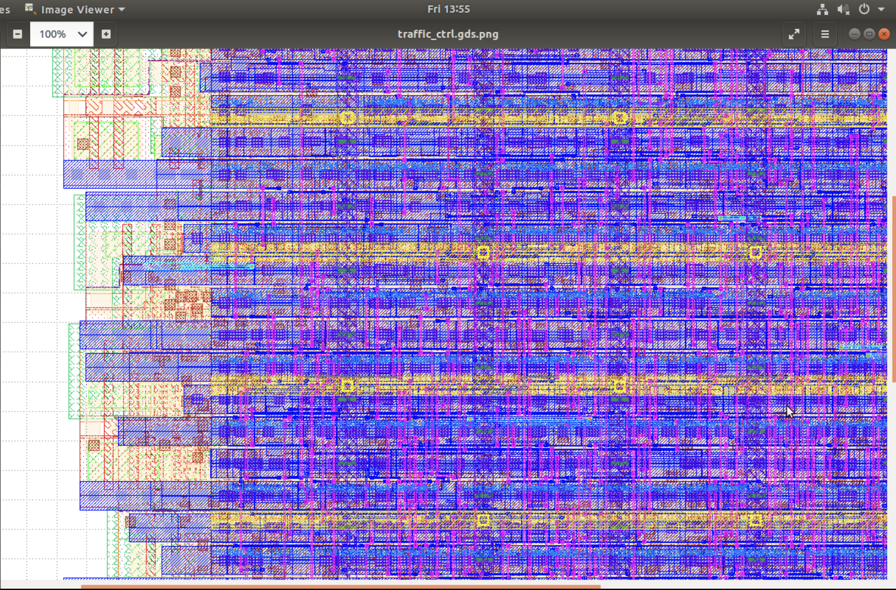
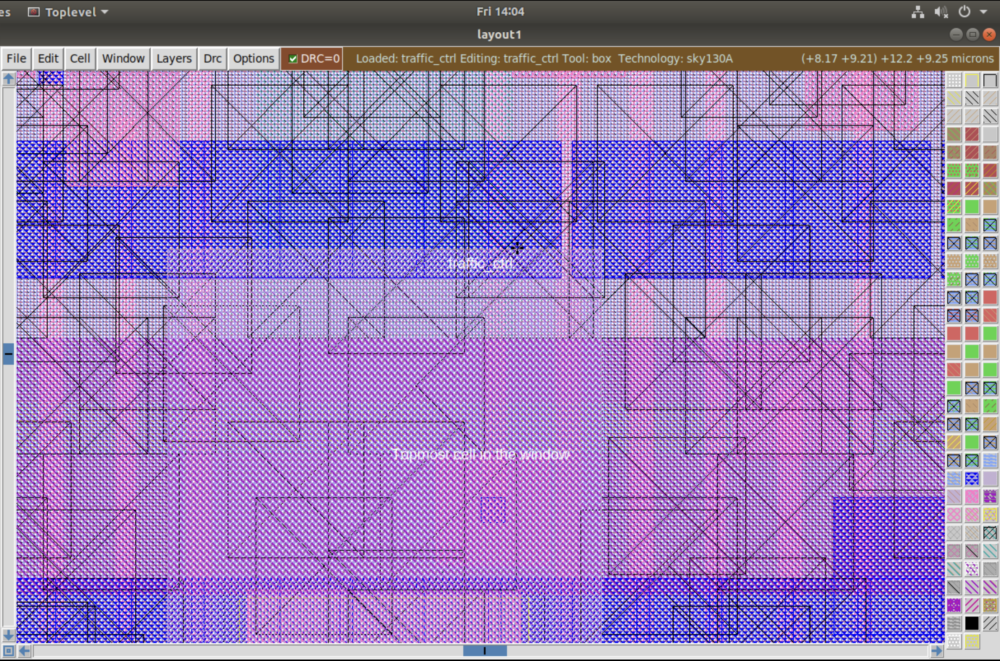
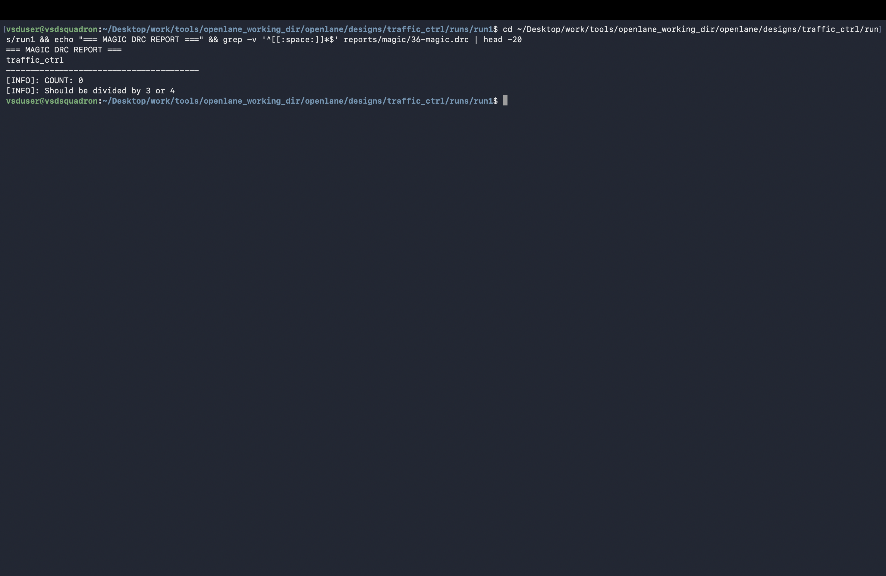
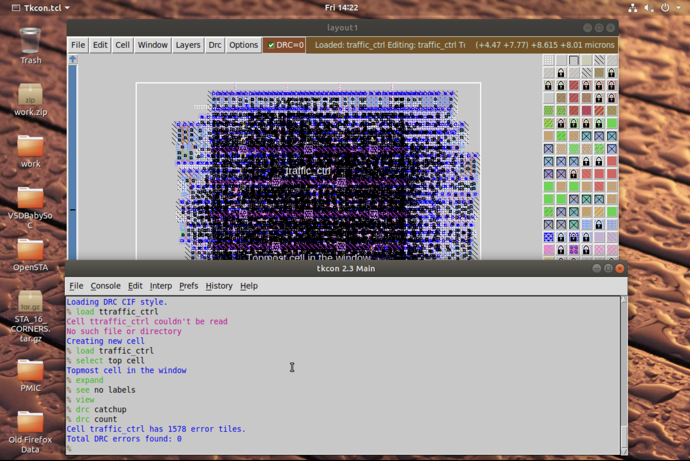
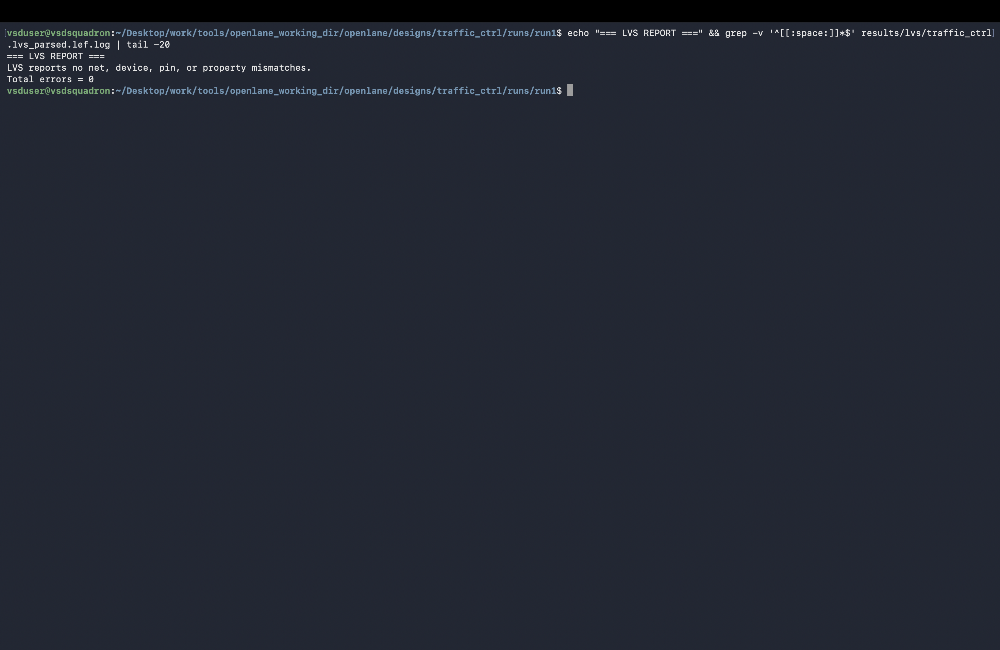
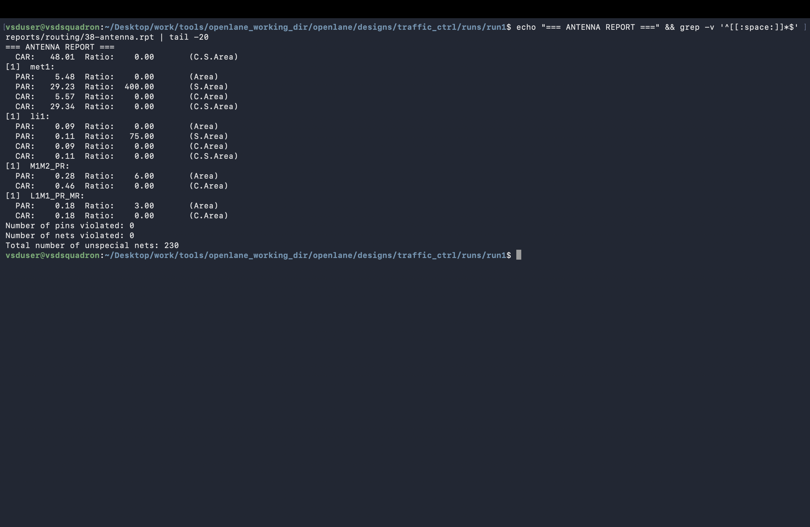
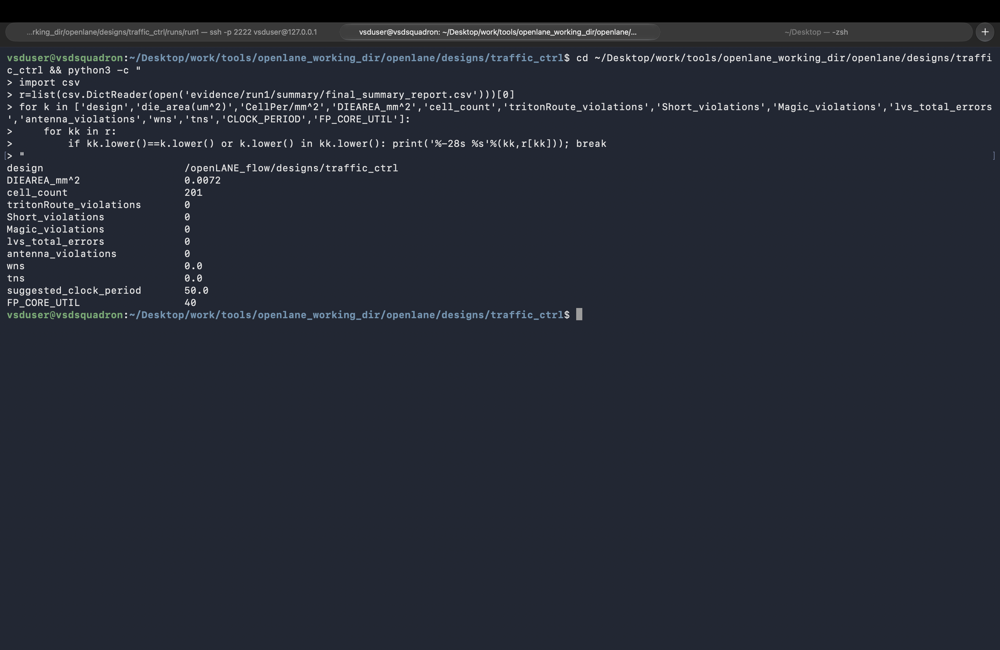

# Signoff and GDS

This section collects screenshots from the completed physical-design flow and its final layout/checks. The project reports zero Magic DRC violations, zero LVS errors, and zero antenna violations for the documented run. These results describe this demonstration run and do not imply fabrication or certification.

## Images

### Completed OpenLane flow

[`12_openlane_flow_complete.png`](12_openlane_flow_complete.png) shows the end of the full OpenLane run.

### Final layout

[`19_final_layout_gds_magic.png`](19_final_layout_gds_magic.png) shows the final GDS layout opened in Magic.

[`20_layout_zoomed_cells.png`](20_layout_zoomed_cells.png) provides a closer view of cells in the final layout.

### Physical verification

[`13_drc_clean.png`](13_drc_clean.png) shows the Magic design-rule-check (DRC) report with a zero violation count.

[`18_drc_magic_layout.png`](18_drc_magic_layout.png) shows the layout associated with the DRC check.

[`14_lvs_clean.png`](14_lvs_clean.png) shows the layout-versus-schematic (LVS) report with zero reported errors or mismatches.

[`15_antenna_clean.png`](15_antenna_clean.png) shows the antenna-rule check result.

### Area and timing summary

[`17_area_and_timing_summary.png`](17_area_and_timing_summary.png) summarizes implementation area and timing metrics for the documented run.

## Related artifacts

Detailed physical-design outputs are stored in [`physical_design/`](../../../physical_design/), including the GDS, DEF, LEF, SPEF, netlists, and reports. Timing reports are in [`sta/`](../../../sta/). The repository README describes the run setup and distinguishes the final `run1` signoff evidence from the separate interactive stage-by-stage captures.
