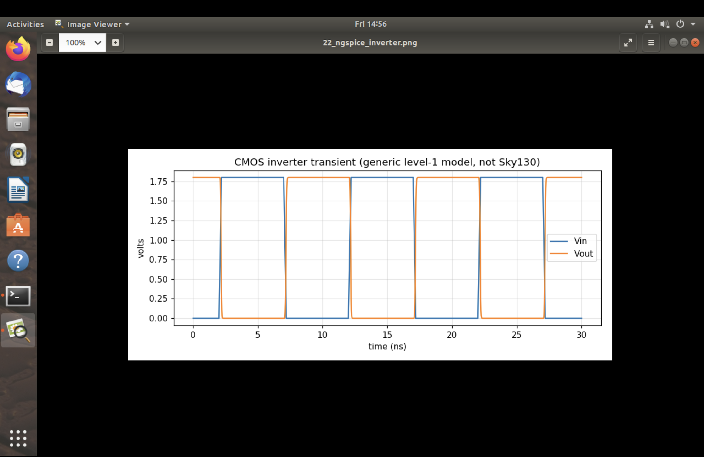

# ngspice Inverter Example

This section contains a transient-response screenshot for a standalone CMOS inverter simulated with ngspice. The circuit and run log are in [`spice/inv.cir`](../../../spice/inv.cir) and [`spice/inv.log`](../../../spice/inv.log).

## Image

[`extra_ngspice_inverter.png`](extra_ngspice_inverter.png) plots the inverter input and output over time, showing the output switching opposite to the pulsed input.

## Model limitation

The circuit uses generic level-1 NMOS/PMOS models and a 1.8 V supply. It is a basic SPICE example, not a simulation of the traffic-controller RTL or a Sky130 transistor-level implementation.
